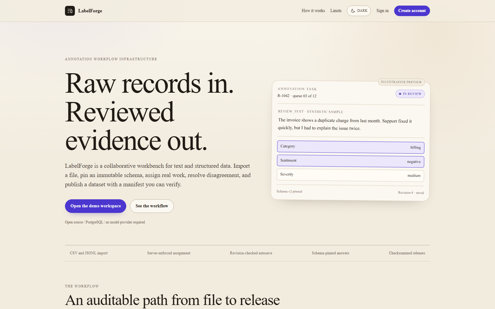
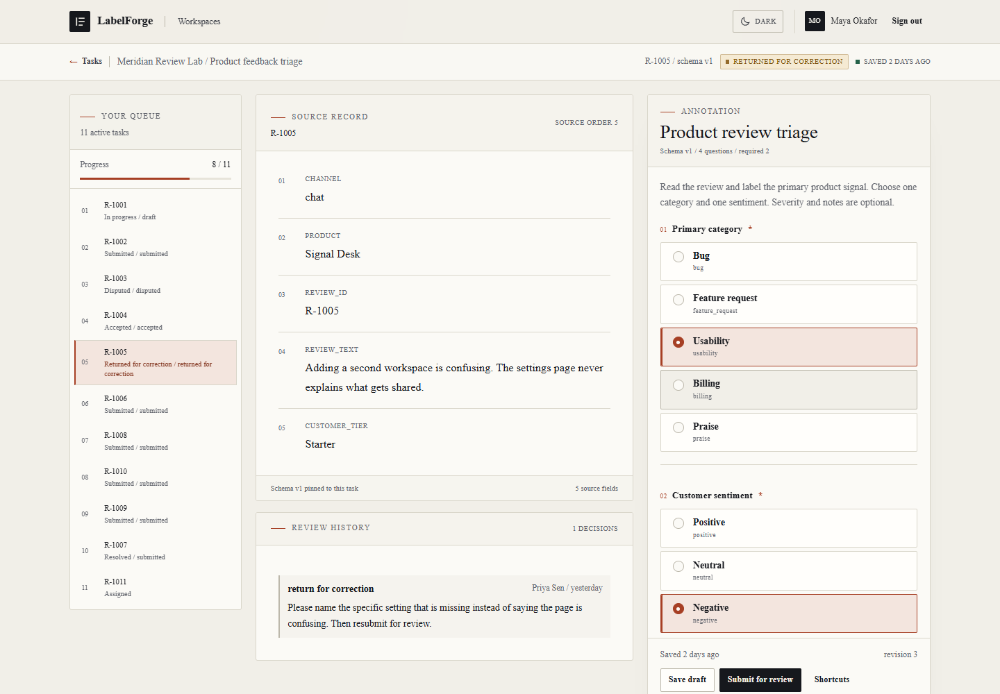
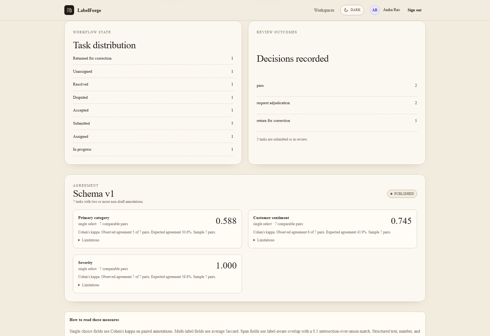
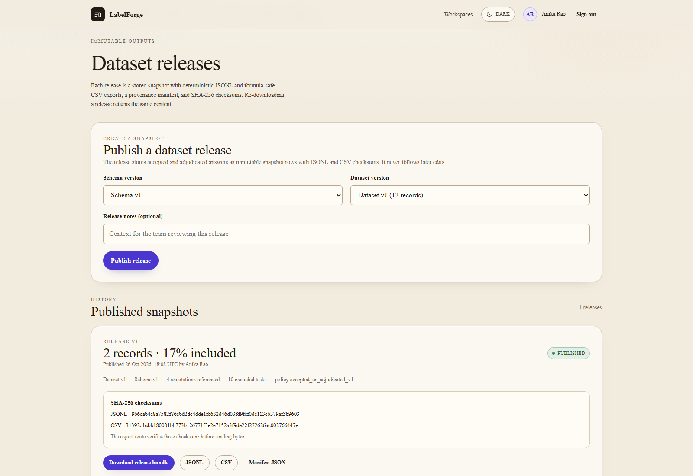

# LabelForge

An auditable, collaborative workbench for turning CSV and JSONL records into reviewed, versioned datasets.

[](https://labelforge-app.vercel.app)
[](https://github.com/devtechedge/labelforge/actions/workflows/ci.yml)
[](https://nextjs.org)
[](https://www.typescriptlang.org)
[](https://www.postgresql.org)
[](LICENSE)

## Live Demo

**https://labelforge-app.vercel.app**

> The demo is backed by Neon PostgreSQL and Vercel Functions. Data persists and is writable. The workspace contains synthetic product reviews and support cases. Do not upload confidential or personal data. The operator can reset the demo.

Demo password: `DemoPass!2026`

| Role | Email |
| --- | --- |
| Owner | owner@labelforge.demo |
| Manager | manager@labelforge.demo |
| Reviewer | reviewer@labelforge.demo |
| Annotator | maya@labelforge.demo |
| Annotator | theo@labelforge.demo |
| No workspace access | outsider@labelforge.demo |

Demo sign-in buttons appear only when `DEMO_MODE=true`. Demo identities are fixed and cannot impersonate other accounts.

## Screenshots

| Landing | Annotation workbench |
| --- | --- |
|  |  |

| Quality measures | Release history |
| --- | --- |
|  |  |

## What it does

LabelForge is a human workflow product, not a model demo. It turns raw structured records into consistent, reviewed, reproducible annotation datasets.

- Import CSV and JSONL with server-side validation, row errors, duplicate quarantine, source identity normalization, preview before commit, and immutable dataset versions.
- Define immutable annotation schema versions with single choice, multiple choice, text, number, boolean, and offset-checked text-span fields.
- Assign work to one or several annotators, reassign without erasing draft history, and enforce role and capacity rules on the server.
- Annotate with revision-checked autosave, explicit save status, conflict recovery, keyboard shortcuts, and accessible text-span alternatives.
- Review submissions with the source record, every answer, differing fields, and review history visible together.
- Return, reject, accept, or request adjudication. A disputed task must enter Adjudication before a final answer is recorded.
- Measure agreement only when the sample supports it. The UI reports the numerator, denominator, sample size, and limitations.
- Publish immutable releases with canonical JSONL, formula-safe CSV, a provenance manifest, and SHA-256 checksums.
- Keep an audit log for workspace, project, import, schema, assignment, review, adjudication, and release actions.

No external model provider is required or called.

## Workflow states

```text
UNASSIGNED -> ASSIGNED -> IN_PROGRESS -> SUBMITTED -> IN_REVIEW
                                                    |-> ACCEPTED
                                                    |-> RETURNED_FOR_CORRECTION
                                                    |-> REJECTED
                                                    |-> DISPUTED -> ADJUDICATION -> RESOLVED
```

An annotation is a separate record from its reviews. A review observes a specific annotation revision. A stale reviewer cannot decide after the annotation changes. A submission key makes retries idempotent.

## Stack

| Layer | Choice |
| --- | --- |
| Application | Next.js 16 App Router, React 19 |
| Language | TypeScript, strict |
| Validation | Zod |
| Database | PostgreSQL 17, Prisma 7 |
| Tests | Vitest, real PostgreSQL integration tests, Playwright |
| Exports | Node crypto, canonical JSON, fflate ZIP bundles |
| Hosting | Vercel Functions, Neon PostgreSQL free tier |

## Quick start

Prerequisites: Node.js 22 or newer, npm, Docker Desktop.

```bash
git clone https://github.com/devtechedge/labelforge.git
cd labelforge
npm ci
docker compose up -d --wait db
cp .env.example .env
npx prisma migrate dev
npm run db:seed
npm run dev
```

Open `http://localhost:3000`. Use the demo buttons on the sign-in page.

The Docker Compose file creates both `labelforge` and `labelforge_test` on a fresh volume. Reset local demo data with `npm run db:reset-demo`. The reset refuses a non-local database unless the guarded demo flags are explicitly set.

## Import formats and limits

CSV requires one header row with unique, non-empty column names. Commas, semicolons, and tabs are supported as delimiters. Quoted fields, escaped quotes, multiline cells, CRLF, and a UTF-8 BOM are handled. JSONL requires one JSON object per line; blank lines are skipped.

| Limit | Value |
| --- | --- |
| Upload per file | 4 MB |
| Rows per import | 10,000 |
| Records per project | 25,000 |
| Fields per record | 60 |
| Field length | 8,000 characters |
| JSONL nesting | 6 levels |
| Preview staging | 1 hour |
| Encoding | UTF-8 |

The application cap is 4 MB because Vercel Functions accept at most 4.5 MB of request body. The interface and parser enforce the app cap; files are never silently truncated. Valid rows commit; invalid rows stay in the preview with row, field, code, and message. Preview commit is transactionally tied to the creator, the checksum, the batch status, and the expiry.

## Schema example

```json
{
  "kind": "labelforge.annotation-schema",
  "version": 1,
  "title": "Product review triage",
  "fields": [
    {
      "key": "category",
      "label": "Primary category",
      "type": "single_select",
      "required": true,
      "options": [
        { "value": "bug", "label": "Bug" },
        { "value": "billing", "label": "Billing" },
        { "value": "praise", "label": "Praise" }
      ]
    }
  ]
}
```

Schema versions are immutable. Publishing makes a version available to task generation. A task references the exact version under which it was created. A schema can be applied to unstarted tasks only through an audited manager action; tasks with any saved answer stay pinned.

## Concurrency and integrity

Every draft write and submission includes an expected annotation revision. The service locks the task, verifies the active assignment and editable state, then performs a conditional update. A stale editor receives a conflict and the current revision, never a silent overwrite.

Task assignment has an exclusive database slot in single-annotator mode and a capacity check in multi-annotator mode. Reassignment releases the old assignment and preserves its annotations. Reviews and adjudications record the exact revision or task version they observed. Releases are created under a project lock and a serializable transaction.

## Agreement measures

- Single choice: Cohen's kappa on pairs of non-draft annotations.
- Multiple choice: average Jaccard over the selected label sets.
- Text spans: label-aware span overlap with a 0.5 intersection-over-union match.
- Insufficient sample: at least five comparable pairs are required; below that the UI says Insufficient comparable annotations.
- Degenerate chance agreement: when every annotator uses one label, kappa is not reported.
- Unsupported fields: text, number, boolean, and structured fields have no invented score.

Every reported metric shows its sample size and limitations. Resolved adjudications are excluded from the agreement sample. These are descriptive statistics for the project sample, not a claim about model quality.

## Releases and export contract

A release includes accepted tasks whose required accepted annotations agree, plus resolved adjudications with a final answer. Unresolved disagreement, incomplete acceptance, and non-final work are excluded and counted by reason.

Each release stores:

- The dataset version and schema version.
- Record identity, source order, normalized record data, final answer, and provenance.
- Selection policy, included count, excluded count, and exclusion reasons.
- SHA-256 checksums for canonical JSONL and formula-safe CSV.
- The full schema and a manifest with the export contract.

JSONL uses canonical JSON with sorted keys, one object per line, ordered by source order. CSV uses a deterministic column order, CRLF rows, quoted text, and prefixes text that begins with `=`, `+`, `-`, `@`, tab, or carriage return. The export route recomputes both forms and verifies the checksums before sending a response. Re-downloading a release returns the same content.

## Tests

```bash
npm run lint
npm run typecheck
npm run test:unit
docker compose up -d --wait db
npm run test:integration
cp .env.test.example .env.test
npx playwright install chromium
npm run e2e
```

Integration tests refuse any database that is not local and named with a `_test` suffix. They cover tenant isolation, role enforcement, import preview and commit, assignment capacity, revision conflicts, duplicate submissions, review decisions, mixed final decisions, adjudication preconditions, schema pinning, release immutability, checksum re-download, and deletion. Playwright covers the public surface, role journeys, a fresh import to release journey, mobile layout, and axe accessibility scans in both themes. CI runs lint, typecheck, unit, integration, build, and Playwright against a PostgreSQL service.

## Deployment

The current production deployment uses Vercel project `labelforge-app` and a Neon PostgreSQL free plan. The project is connected to this GitHub repository and deploys from `main`.

Required environment variables:

| Name | Purpose |
| --- | --- |
| `DATABASE_URL` | Pooled PostgreSQL connection for the app |
| `DATABASE_URL_UNPOOLED` | Direct connection for migrations and guarded seeding |
| `NEXT_PUBLIC_APP_URL` | Public production origin |
| `DEMO_MODE` | Enables the fixed demo identities |
| `DEMO_DEPLOYMENT` | Marks an isolated demo for seed guards |

Deployment sequence:

```bash
npm run db:deploy
DEMO_DEPLOYMENT=true DEMO_ALLOW_PROD_SEED=1 npm run db:seed
npm run build
```

A production reset additionally requires `DEMO_ALLOW_RESET=1`. Never run the seed against a non-demo production database. `GET /api/health` checks database reachability and returns no connection details.

Preview and production currently share the demo database. That is acceptable only because the deployment is an isolated synthetic demo; it is documented as a limitation, not a multi-tenant production pattern.

## Security and privacy

Sessions use hashed opaque tokens in HTTP-only cookies; passwords use salted scrypt hashes. Invitation tokens are hashed, expire after seven days, and are bound to the invited email. Mutating APIs require a same-origin request. Workspace membership is checked on every tenant-scoped operation. Uploaded content is rendered as text. CSV exports protect against spreadsheet formula execution. Dataset content and tokens are not logged.

The public demo is writable and contains synthetic data only. See [SECURITY.md](SECURITY.md) and the in-app [privacy policy](https://labelforge-app.vercel.app/privacy) for the threat model and retention behavior. The product is not a compliance certification and must not be used for regulated personal data.

## Known limitations

- First release supports text and structured records only. Image, audio, video, and arbitrary code workflows are out of scope.
- There is no invitation email delivery, password reset, email verification, MFA, or organization SSO.
- There is no account disablement interface, although the database and session checks support a disabled user.
- Each project has one dataset lineage. A release covers one dataset version and one published schema version.
- The demo is writable and persistent. Preview and production share its database.
- Import previews are cleaned opportunistically rather than by a dedicated cron job.
- Agreement measures are descriptive and require at least five comparable pairs.
- The import UI requires a CSV header row.
- No billing, object storage, webhook, public API token, or external model integration is included.

## Architecture

The App Router handles server-rendered pages and route handlers. Server actions cover form flows that need progressive enhancement, and JSON APIs cover autosave, imports, reviews, adjudication, and exports. A domain layer holds schema, answer, workflow, agreement, and export rules. Service modules enforce authorization and transactions. Repositories scope database reads. Prisma migrations define the PostgreSQL schema.

The architecture decision record for immutable schemas, optimistic concurrency, review separation, agreement metrics, and release reproducibility is [ADR 0001](docs/adr/0001-annotation-integrity.md).

## License

MIT. See [LICENSE](LICENSE).
